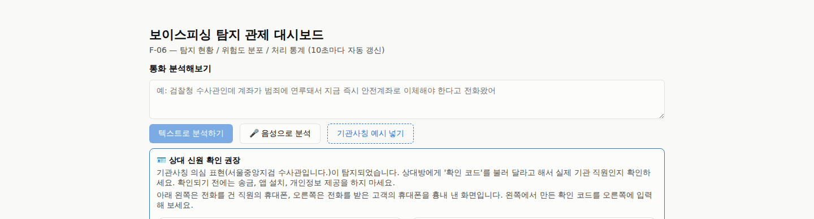
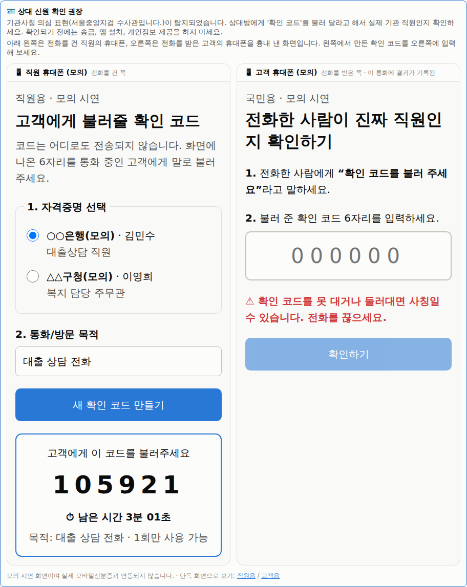
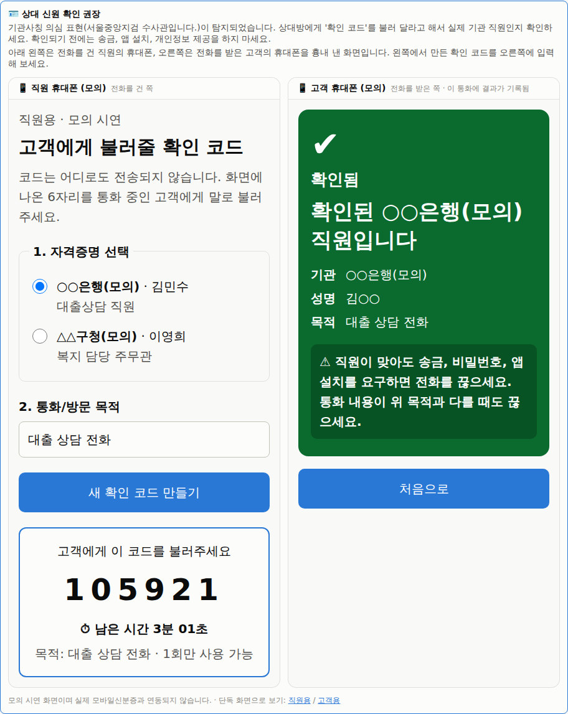
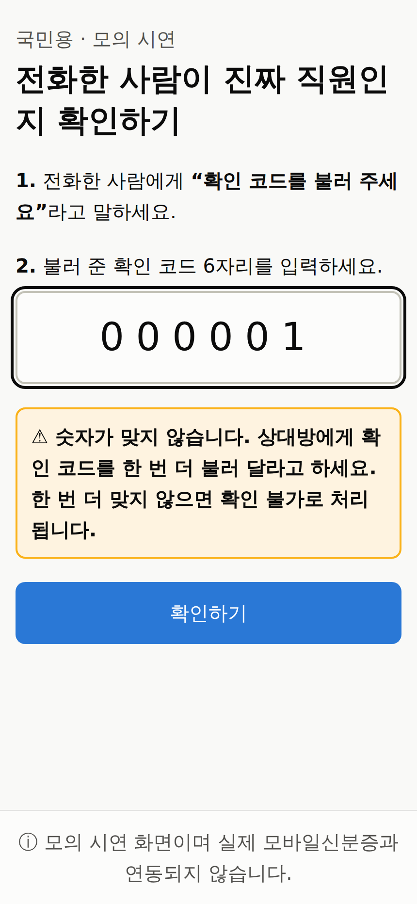
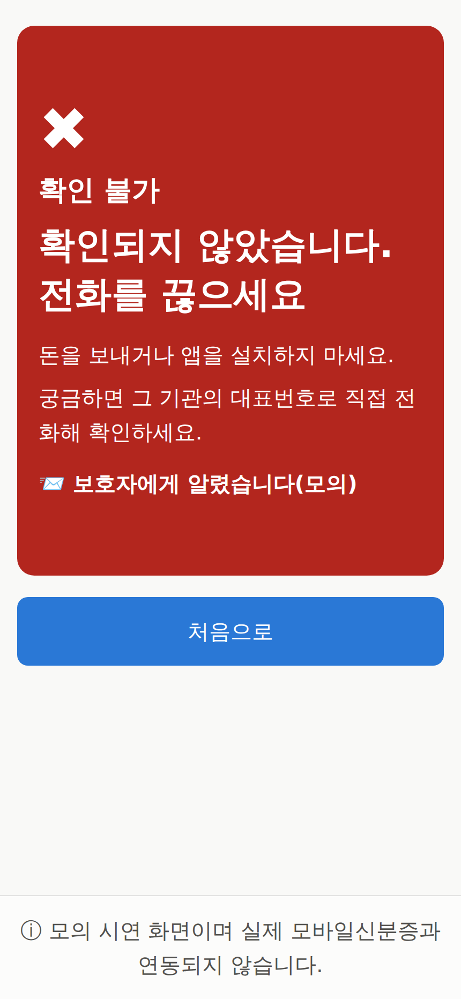
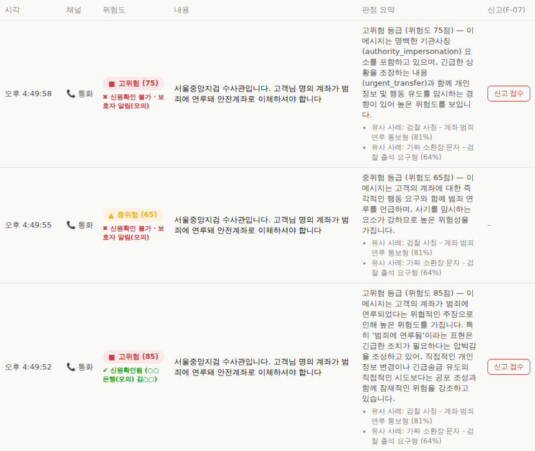
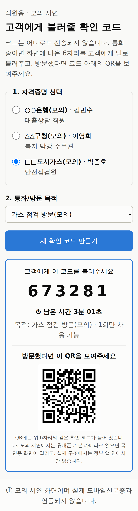
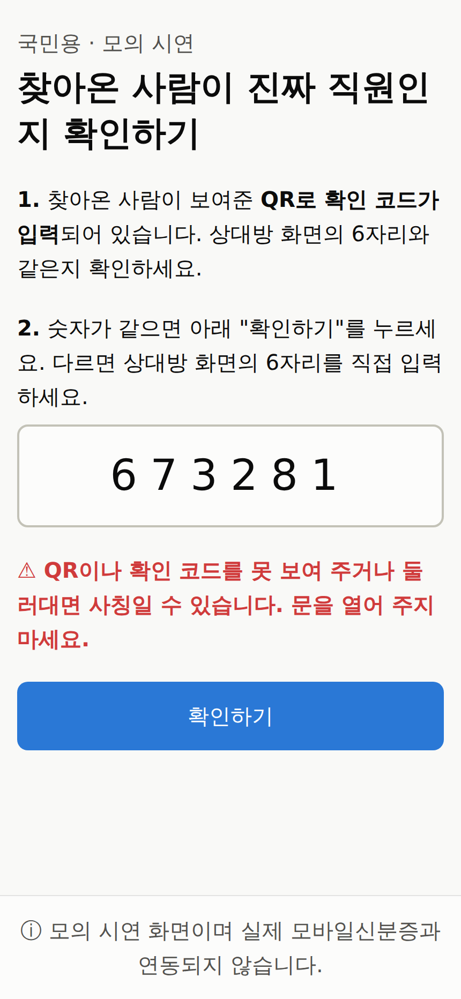
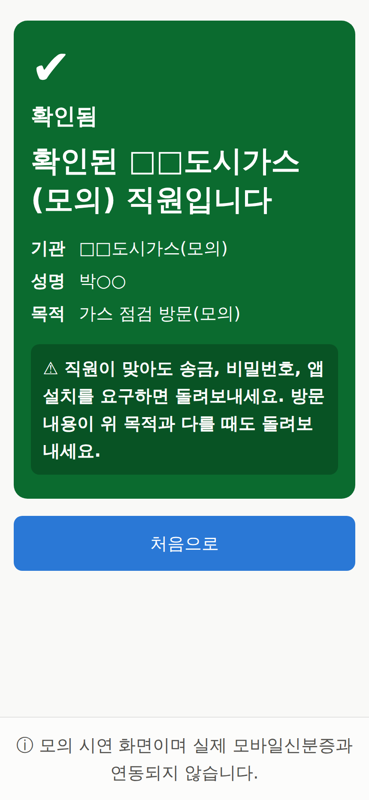

# 역방향 신원확인 POC (모의 시제품)

> **고지**: 이 문서와 `apps/verify-worker`는 「2026 모바일신분증 아이디어 공모전」에 제출할
> 아이디어의 **구조를 모사한 시제품**이다. 실제 모바일신분증 시스템, 정부/기관 시스템과
> **연동하지 않는다**. 기관은 전부 "○○은행(모의)"처럼 가상이고, 서명 키는 프로세스가
> 기동할 때 메모리에서 만든 모의 키이며, 보호자 알림은 발송 없이 기록만 남긴다.

## 1. 아이디어

| 지금 | 이 POC |
|---|---|
| 국민이 기관에 신분을 증명한다 | 전화를 건 기관 직원/방문자가 **재직 자격증명**으로 먼저 자신을 증명한다 |
| 국민은 상대가 진짜 직원인지 확인할 수단이 없다 | 국민은 6자리 코드(전화) 또는 방문자가 보여준 QR(방문)로 확인하고 **확인됨(초록) / 확인 불가(빨강)** 두 결과만 본다 |

역할 분담은 **"AI가 의심하고, 신분증이 확정한다"**. 이 저장소의 탐지(F-01)가 기관사칭을
의심하면 판정 응답의 `verification_prompt`로 "상대 신원을 확인하세요"라고 안내하고, 상대가
실제 직원인지는 verify-worker의 서명 검증이 확정한다. AI 판정은 확률적이라 "이 사람은 진짜
직원"이라고 확정할 수 없지만, 서명 검증은 결정적(deterministic)이다.

## 2. 구조도

```
 [모의 기관]                    [직원]                          [국민]
     │ ① 자격증명 발급               │ ② 일회용 증명 생성             │ ④ 코드 입력
     │ POST /credentials           │ POST /proofs                 │ /verify/citizen
     ▼                             ▼                              ▼
┌──────────────────── apps/verify-worker (8400, 모의) ─────────────┐  ┌──── apps/api (8000) ────┐
│ domain        Credential / Proof / VerificationResult           │  │ domain                   │
│               사유 코드(N-04), 성명 마스킹(김○○)                 │  │  decide_verification_    │
│ application   발급 / 폐기 / 증명 생성 / 검증 유스케이스           │◄─┤  prompt()  ← F-01 결과   │
│ infrastructure 발급 측: Ed25519 기관별 개인키(모의 키, 메모리)     │⑤ │ application              │
│               검증 측: 공개키 레지스트리 + 공개키 검증기          │  │  CallVerificationService │
│               인메모리 저장소(자격증명, 폐기 목록, 증명)          │  │                          │
│               FastAPI, /metrics (vps_verify_*)                  │  │ infrastructure           │
└─────────────────────────────────────────────────────────────────┘  │  verify-worker 클라이언트 │
     ▲                                                               │  보호자 알림 mock         │
     │ ③ 6자리 코드를 말로 전달(전화) / QR을 보여줌(방문)               │  검증 기록(인메모리)      │
                                                                     └──────────────────────────┘
 ⑤ api가 /api/v1/verify 호출 → 결과를 call_id 통화 기록에 붙임 → 확인 불가면 보호자 알림(mock)
```

### 발급(서명)과 검증(공개키)의 분리

모의 발급 기관은 3곳이고 기관마다 서로 다른 Ed25519 키쌍을 갖는다.

| `issuer_id` | 기관 | 시드 자격증명 |
|---|---|---|
| `mock-bank` | ○○은행(모의) | `demo-bank-staff` 김민수, 대출상담 직원 |
| `mock-district` | △△구청(모의) | `demo-district-staff` 이영희, 복지 담당 주무관 |
| `mock-gas` | □□도시가스(모의) | `demo-gas-staff` 박준호, 안전점검원(방문 시나리오) |

```
 발급 측                                         검증 측
 IssueCredentialService                          VerifyProofService
   └ IssuerSigningPort.sign(issuer_id, …)          ├ IssuerPublicKeyRegistryPort.get_public_key(issuer_id)
       = Ed25519IssuerSigner (개인키 보유)          └ SignatureVerifierPort.verify(public_key, …)
            │ 기동 시 공개키 바이트만 등록                 = Ed25519SignatureVerifier (상태 없음)
            ▼
   InMemoryIssuerPublicKeyRegistry (공개키 + 기관 정보만) ── GET /api/v1/issuers
                                                         GET /api/v1/issuers/{issuer_id}/public-key
```

- 자격증명에 `issuer_id`가 들어가고 서명 대상에도 포함된다. 발급 기관을 바꿔치기하면 서명이
  깨진다.
- 검증 유스케이스는 서명 포트를 생성자 인자로 받지 않는다. 그래서 코드 구조상 개인키에 닿을 수
  없다. 레지스트리는 `register(issuer, public_key: bytes)`로 공개키 바이트만 받는다.
- 검증 측이 레지스트리 객체를 공유하지 않고 공개키 바이트 사본만 받아도 검증되는 것을 테스트로
  고정했다(`test_verification_needs_only_public_key_copy`).
- 레지스트리 응답은 공개키를 raw(hex)와 PEM으로 함께 주고, 모의 키라는 고지를 붙인다.

검증 판정 순서(`VerifyProofService`): **코드 없음 → 발급 기관 불명 → 서명 불일치 → 폐기 → 만료 →
이미 사용됨**.
하나라도 걸리면 `verified=false`이고 사유 코드만 다르다. 서명을 먼저 보는 이유는, 위·변조된
자격증명이 "만료" 같은 가벼운 사유로 가려지지 않게 하기 위해서다. 사용 처리는 모든 검사를
통과한 뒤에만 한다(실패한 시도가 정상 증명을 소모하지 않음).

| 사유 코드 (`reason`) | 의미 | 대표 시나리오 |
|---|---|---|
| `verified` | 서명·폐기·만료·사용 여부 모두 통과 | 정상 직원 |
| `code_not_found` | 그 코드로 발급된 증명이 없음 | 사칭범 |
| `issuer_unknown` | 자격증명이 주장하는 발급 기관(`issuer_id`)이 공개키 레지스트리에 없음 | 출처 불명 자격증명 |
| `signature_invalid` | 자격증명 내용과 기관 서명이 불일치(다른 기관 키로 서명된 경우 포함) | 위·변조 |
| `credential_revoked` | 자격증명이 폐기됨 | 퇴사자 |
| `proof_expired` | 증명 유효시간(기본 180초) 경과 | 오래된 코드 |
| `proof_already_used` | 이미 한 번 검증에 쓰인 코드 | 재사용 시도 |
| `rate_limited` | 같은 클라이언트가 짧은 시간에 너무 많이 틀려 검증하지 않고 거절(HTTP 429) | 무차별 대입 |

**입력 실수 재시도**(api `allows_code_retry`): `code_not_found`는 사칭범일 수도, 어르신이 숫자
하나를 잘못 누른 것일 수도 있다. 그래서 같은 통화에서 **연속 첫 번째** `code_not_found`는
확인 불가로 확정하지 않고 `retry_allowed: true`로 응답한다. 이때 화면은 "숫자가 맞지 않습니다.
한 번 더 불러 달라고 하세요"를 보여주고, 보호자 알림도 남기지 않는다. 연속 두 번째부터는 확인
불가와 보호자 알림(모의)으로 처리한다. 폐기/만료/재사용/서명 불일치는 입력 실수로 생길 수 없어서
첫 시도에도 바로 확인 불가다. 연속 횟수는 다른 결과(확인됨 등)가 나오면 0부터 다시 센다.
6자리 코드를 두 번 안에 맞힐 확률은 2/10^6이라, 한 번 더 기회를 줘도 사칭범에게 실질적인
이득은 없다.

**방문 시나리오(QR)**: 직원 화면은 코드를 만들 때 같은 증명을 담은 QR도 함께 보여준다. QR 내용은
국민용 화면 주소 + 코드(`/verify/citizen?code=XXXXXX`)이고, 국민 화면은 주소의 코드를 입력칸에
미리 채우기만 한다. 검증은 거주자가 "확인하기"를 눌러야 시작된다(주소를 연 것만으로는 검증 요청이
나가지 않음 — 3장 방문 시나리오에서 요청 수로 확인). 코드가 주소로 들어오면 화면 문구도 방문
상황("문을 열어 주지 마세요")으로 바뀐다.

> **실제 구조와의 차이**: 실제 구조에서는 휴대폰 카메라로 링크를 여는 방식이 아니라 **정부 앱
> 안에서 QR을 읽어야 한다.** 국민에게 "QR을 찍어 열린 링크를 믿으라"고 가르치면, 가짜 QR이 가짜
> 확인 화면을 띄우는 QR 링크 피싱(큐싱)에 그대로 노출된다. 이 POC가 링크를 여는 방식을 쓴 것은
> 휴대폰 기본 카메라만으로 시연하기 위한 편의일 뿐이다.

**코드 입력 횟수 제한(무차별 대입 방어)**: 클라이언트(IP)별로 **10분에 실패 5회**를 넘으면
다음 시도부터 검증하지 않고 **HTTP 429 + `reason: rate_limited`**로 거절한다. 환경변수
`VERIFY_RATE_LIMIT_MAX_FAILURES`, `VERIFY_RATE_LIMIT_WINDOW_SECONDS`로 조정한다. 새 의존성 없이
인메모리 슬라이딩 윈도우로 구현했다.

- api(`POST /api/v1/calls/{call_id}/verification`)와 verify-worker(`POST /api/v1/verify`) 양쪽에
  같은 규칙을 건다. api를 거치지 않고 verify-worker를 직접 두드려도 막힌다.
- 국민 검증은 api를 거쳐 오므로 verify-worker에는 모든 요청이 api의 IP로 보인다. 그래서 api가
  실제 클라이언트 IP를 `X-Forwarded-For`로 넘기고, verify-worker는 신뢰 프록시
  (`VERIFY_TRUSTED_PROXIES`, 기본 `127.0.0.1,::1`)에서 온 요청일 때만 이 헤더를 믿는다. 아무
  데서나 온 헤더를 믿으면 헤더만 바꿔 제한을 우회할 수 있다.
- **"실패"는 `verified=false`인 모든 결과**다. 입력 실수 재입력 안내(`retry_allowed: true`)도
  실패 1회로 센다. 재입력 허용은 보호자 알림을 미루는 것이지, 시도 횟수를 공짜로 주는 게
  아니다. 성공은 세지 않고, 제한으로 거절된 시도도 다시 세지 않는다.
- 제한에 걸리면 그 사이에 맞는 코드를 넣어도 통과시키지 않는다. 정상 증명도 소모하지 않는다.
- 재입력 허용 규칙과의 관계: 한 번이라도 제한에 걸린 통화는 윈도우가 지나도 재입력 허용이
  되살아나지 않는다(`allows_code_retry`).
- 국민 화면은 429를 "잠시 후 다시 시도하세요"가 아니라 **확인 불가와 같은 빨간 화면**으로
  보여준다. 제한에 걸릴 만큼 틀렸다면 끊는 게 맞다. 그래서 api는 이 경우에도 통화 기록과 보호자
  알림(모의)을 확인 불가와 똑같이 남긴다.
- 메트릭 `vps_verify_rate_limited_total`이 api와 verify-worker 양쪽에 있다. Prometheus에서는
  job 라벨로 구분한다. verify-worker의 `vps_verify_requests_total`에도 `reason="rate_limited"`로
  남는다.

국민용 화면은 사유 코드를 보여주지 않고 두 결과만 보여준다. 사유 코드와 사람이 읽을
문구(`message`)는 API 응답과 통화 기록, 메트릭 라벨에 남는다(N-04).

**노출 최소화**: `verified=true`여도 국민에게는 기관명, 마스킹된 성명(김○○), 목적, 만료시각만
나간다. credential_id, 역할, 서명은 내보내지 않는다(`tests/test_verify_response.py`가 응답
키 집합을 고정함).

## 3. 시나리오별 실제 실행 결과 (2026-10-12, 전체 경로)

postgres, Ollama, 백엔드 5개(api / mcp-server / rag-worker / stt-worker / verify-worker),
frontend를 실행 스킬(`.claude/skills/run-voice-phishing-detector/SKILL.md`) 그대로 띄우고,
`capture_poc.mjs`(같은 폴더)로 화면을 조작해 얻은 응답 원문과 캡처다. 요청은 전부 실제로 떠 있는
api(8000)와 verify-worker(8400)를 거쳤고, 가로채거나 흉내 낸 응답은 없다. 코드, 시각, ID는
실행할 때마다 다르다. 국민 측 검증은 api(`POST /api/v1/calls/{call_id}/verification`,
`X-API-Key: dev-handler-key`)를 거친다. 캡처는 `docs/images/poc/`에 있다.

### 0단계: 통화 분석 → 신원확인 안내 (`verification_prompt`)

대시보드 "통화 분석해보기"에서 "기관사칭 예시 넣기" → "텍스트로 분석하기". 예시 문장은 합성
문장이다(실제 통화 아님). `POST /api/v1/calls/analyze` 응답에서 기존 필드는 그대로이고, 아래
두 필드가 추가로 붙는다(일부 필드 생략).

```
$ POST :8000/api/v1/calls/analyze {"transcript":"서울중앙지검 수사관입니다. 고객님 명의 계좌가 범죄에 연루돼 안전계좌로 이체하셔야 합니다"}
{"call_id":"eaacdd09-00da-4fd1-8a46-d3db1ea8de41","risk_score":85,"risk_level":"high",
 "detected_patterns":[
   {"category":"authority_impersonation","category_label":"기관사칭","matched_keywords":["서울중앙지검 수사관입니다."]},
   {"category":"fear_inducement","category_label":"공포조성","matched_keywords":["고객님 명의 계좌가 범죄에 연루됨"]}],
 …,
 "verification_prompt":{"required":true,
   "message":"기관사칭 의심 표현(서울중앙지검 수사관입니다.)이 탐지되었습니다. 상대방에게 '확인 코드'를 불러 달라고 해서 실제 기관 직원인지 확인하세요. 확인되기 전에는 송금, 앱 설치, 개인정보 제공을 하지 마세요."},
 "identity_verifications":[]}
```

기관사칭 패턴(`authority_impersonation`)이 있거나 `risk_level == "high"`면 안내하고, 해당 없으면
`{"required": false}`다. 같은 예시 문장을 세 번 분석했더니 위험도는 85(고위험), 65(중위험),
75(고위험)로 실행마다 달랐다(LLM 판정). 그래도 기관사칭 패턴은 세 번 모두 탐지돼 안내는 매번
떴다. AI 판정은 이렇게 흔들릴 수 있어서, "진짜 직원인가"는 AI가 아니라 서명 검증이 확정한다.



### 시나리오 1: 정상 직원 → 확인됨

0단계의 통화(`eaacdd09-…`) 아래에 뜬 직원 휴대폰(모의)에서 "확인 코드 만들기" → 고객 휴대폰
(모의)에 그 코드를 입력 → "확인하기".

```
$ POST :8000/api/v1/calls/eaacdd09-00da-4fd1-8a46-d3db1ea8de41/verification {"code":"105921"}
{"call_id":"eaacdd09-00da-4fd1-8a46-d3db1ea8de41","verified":true,"reason":"verified",
 "message":"기관(모의)이 서명한 재직 자격증명과 일회용 증명이 모두 유효합니다.",
 "verified_at":"2026-10-12T07:49:52.753304+00:00","retry_allowed":false,
 "institution_name":"○○은행(모의)","staff_display_name":"김○○","purpose":"대출 상담 전화",
 "expires_at":"2026-10-12T07:52:52.527210+00:00","guardian_notification":null}
```




### 시나리오 2: 사칭범 (발급된 적 없는 코드) → 1회차 재입력 안내, 2회차 확인 불가

같은 예시 문장을 새로 분석해 받은 call_id로 국민용 화면(`/verify/citizen?call_id=…`)을 열고,
발급된 적 없는 코드를 두 번 넣었다.

```
$ POST :8000/api/v1/calls/9a76146f-5907-4204-9e2d-f8b70324471f/verification {"code":"000000"}   # 1회차
{"call_id":"9a76146f-5907-4204-9e2d-f8b70324471f","verified":false,"reason":"code_not_found",
 "message":"입력한 코드로 발급된 증명이 없습니다. 상대방이 기관 직원임을 증명하지 못했습니다.",
 "verified_at":"2026-10-12T07:49:55.994670+00:00","retry_allowed":true,"guardian_notification":null}

$ POST :8000/api/v1/calls/9a76146f-5907-4204-9e2d-f8b70324471f/verification {"code":"000001"}   # 2회차
{"call_id":"9a76146f-5907-4204-9e2d-f8b70324471f","verified":false,"reason":"code_not_found",
 "message":"입력한 코드로 발급된 증명이 없습니다. 상대방이 기관 직원임을 증명하지 못했습니다.",
 "verified_at":"2026-10-12T07:49:56.132794+00:00","retry_allowed":false,
 "guardian_notification":{"notification_id":"d418bac0-e203-43ad-bccd-f876d50d9bc2","status":"logged",
   "created_at":"2026-10-12T07:49:56.132785+00:00",
   "note":"MOCK: 실제 보호자 알림(문자/푸시) 발송 없음 — 모의 시연용 기록만 남김"}}
```




### 시나리오 3: 퇴사자 (증명 생성 → 폐기 → 검증) → 확인 불가

(이 실행 이후 발급·검증 분리(2장)로 자격증명 응답에 `"issuer_id":"mock-bank"` 필드가 추가됐다.
기관명으로 발급하는 아래 요청은 그대로 받는다. 등록된 모의 기관과 대응시키는 방식이다.)

직원용 화면에는 폐기 버튼이 없어서, 발급·증명 생성·폐기는 verify-worker API를 직접 호출했다.
시드 자격증명(`demo-bank-staff`)은 폐기하지 않고 새로 발급한 것을 폐기했다. 그 뒤 새로 분석한
통화의 국민용 화면에 코드를 넣었다.

```
$ POST :8400/api/v1/credentials {"institution_name":"○○은행(모의)","staff_display_name":"최퇴사","role":"대출상담 직원"}
{"credential_id":"d1a74044-758e-47a1-871c-fce08ad60a3a","institution_name":"○○은행(모의)",
 "staff_display_name":"최퇴사","role":"대출상담 직원","issued_at":"2026-10-12T07:49:56.226652+00:00",
 "signature":"be5a2213…1976280e","revoked":false}

$ POST :8400/api/v1/proofs {"credential_id":"d1a74044-…","purpose":"대출 상담 전화"}
{"code":"156194","purpose":"대출 상담 전화","expires_at":"2026-10-12T07:52:56.230653+00:00","ttl_seconds":180}

$ POST :8400/api/v1/credentials/d1a74044-…/revoke
{"credential_id":"d1a74044-758e-47a1-871c-fce08ad60a3a","revoked":true}

$ POST :8000/api/v1/calls/fb79b04f-7709-4574-a67c-38476d1c4306/verification {"code":"156194"}
{"call_id":"fb79b04f-7709-4574-a67c-38476d1c4306","verified":false,"reason":"credential_revoked",
 "message":"자격증명이 폐기되었습니다(퇴사 등으로 더 이상 재직 중이 아님).",
 "verified_at":"2026-10-12T07:49:59.293071+00:00","retry_allowed":false,
 "guardian_notification":{"notification_id":"fb7491fa-45fa-4d74-afc0-876f79627d0c","status":"logged",…}}
```

국민 화면은 사칭범(05)과 퇴사자(06)가 똑같은 빨간 화면이다. 국민에게는 두 결과만 보여주고,
사유 코드(`code_not_found` / `credential_revoked`)는 응답과 통화 기록에만 남긴다(2장).


### 대시보드에 남은 결과

세 통화의 신원확인 결과가 "최근 탐지 현황" 표의 해당 통화에 배지로 붙는다(위에서부터 퇴사자,
사칭범, 정상 직원).



### 시나리오 4: 방문 (QR) → 확인됨

직원용 화면(`/verify/staff`)에서 □□도시가스(모의) 박준호(안전점검원) 선택, 목적 "가스 점검
방문(모의)" → "확인 코드 만들기". 코드 아래에 QR이 뜬다. QR 이미지를 디코더(OpenCV
`QRCodeDetector`)로 읽은 내용은 `http://localhost:3001/verify/citizen?code=673281`로, 화면의
코드와 같았다. 그 주소를 열면(휴대폰 기본 카메라가 하는 일) 입력칸에 `673281`이 채워진 채로
멈춰 있고, 이때까지 검증 요청은 0건이었다. "확인하기"를 누른 뒤에야 아래 요청이 나갔다
(call_id 없이 연 단독 화면이라 `standalone`으로 기록).

```
$ POST :8000/api/v1/calls/standalone/verification {"code":"673281"}
{"call_id":"standalone","verified":true,"reason":"verified",
 "message":"기관(모의)이 서명한 재직 자격증명과 일회용 증명이 모두 유효합니다.",
 "verified_at":"2026-10-12T07:56:45.428794+00:00","retry_allowed":false,
 "institution_name":"□□도시가스(모의)","staff_display_name":"박○○","purpose":"가스 점검 방문(모의)",
 "expires_at":"2026-10-12T07:59:44.351681+00:00","guardian_notification":null}
```





### 코드 입력 횟수 제한 (실제 실행, 2026-10-12)

api와 verify-worker를 재시작해 기록을 비운 뒤, 같은 클라이언트(127.0.0.1)에서 api로 발급된 적
없는 코드를 6번 넣었다.

```
1: 200 code_not_found  retry_allowed=true   보호자 알림 없음   # 입력 실수 재입력 안내 — 실패 1회로 셈
2: 200 code_not_found  retry_allowed=false  보호자 알림(모의)
3~5: 200 code_not_found  retry_allowed=false  보호자 알림(모의)
6: 429
{"call_id":"live-rl-1791792328","verified":false,"reason":"rate_limited",
 "message":"짧은 시간에 확인 코드를 너무 여러 번 틀렸습니다(무차별 대입 의심). 검증하지 않고 거절했습니다.",
 "verified_at":"2026-10-12T08:05:28.596774+00:00","retry_allowed":false,
 "guardian_notification":{"notification_id":"ca2c18ae-1fb5-4086-a72d-d4c105132c5f","status":"logged",…}}
```

이어서 같은 클라이언트가 api를 거치지 않고 verify-worker(`:8400/api/v1/verify`)를 직접 호출해도
`429 rate_limited`였다. api가 넘긴 `X-Forwarded-For`로 verify-worker 쪽에도 실패 5회가 쌓였기
때문이다. 다른 IP(`X-Forwarded-For: 198.51.100.20`)는 같은 시각에 막히지 않고 `200
code_not_found`였다. 이때 메트릭은 api `vps_verify_rate_limited_total 1.0`, verify-worker
`vps_verify_rate_limited_total 1.0`이었다. 국민 화면(Playwright)에서 제한에 걸린 상태로 코드를
넣으면 429를 받고, 확인 불가와 같은 빨간 화면과 "보호자에게 알렸습니다(모의)"가 떴다. 화면은
05번 캡처와 같아서 따로 싣지 않았다.

같은 세 시나리오를 curl로만 돌리려면 `apps/verify-worker/scripts/demo_scenarios.sh`를 쓴다
(분석 단계 없이 고정 call_id 사용).

## 4. 실측 검증 소요시간

측정 환경: Intel i7-8700(12 스레드), WSL2, Python 3.14, uvicorn 단일 워커, 같은 호스트의
루프백. warm-up 5건 후, 매번 새 증명을 만들어 `verified=true` 경로만 경로별로 200건 순차
측정했다(httpx 클라이언트 1개 재사용). 두 번 측정했고, 방법은 같다.

| 구간 | 측정 | 평균 | p50 | p95 | 최대 |
|---|---|---|---|---|---|
| 서버 내부: 검증 1건 (`vps_verify_duration_seconds` 증분 sum/count) | 1차 | 0.146ms | – | – | – |
| | **2차** | **0.180ms** | – | – | – |
| HTTP 왕복: verify-worker `POST /api/v1/verify` 직접 | 1차 | 0.96ms | 0.91ms | 1.21ms | 2.08ms |
| | **2차** | **1.03ms** | **0.98ms** | **1.33ms** | **1.59ms** |
| HTTP 왕복: api `POST /api/v1/calls/{id}/verification` 경유 | 1차 | 8.73ms | 8.72ms | 9.44ms | 10.17ms |
| | **2차** | **9.63ms** | **9.24ms** | **11.03ms** | **41.02ms** |

- **1차**(2026-10-12, 작업 3·4 전): 서명과 검증이 한 어댑터에 있고, 속도 제한은 없었다. api는
  당시 브랜치 코드를 8010 포트에 따로 띄워 쟀다.
- **2차**(2026-10-12, 작업 3·4 후): 공개키 레지스트리 조회 + 공개키 검증(2장)으로 바뀌었다.
  verify-worker와 api 양쪽에 실패 횟수 제한이 붙었고, api는 systemd로 띄운 8000 포트를 쟀다.
  서버 내부 시간은 2차부터 실패 횟수 제한 확인(인메모리 조회)을 포함한다. 히스토그램 관측
  위치가 제한 확인을 감싸는 유스케이스로 옮겨졌기 때문이다.
- 1차와 2차의 차이가 구조 변경 때문인지 실행마다 생기는 편차인지는 가르지 않았다(각 1회
  측정). 2차 api 경유 최대값 41.02ms는 200건 중 1건이고, 원인은 확인하지 않았다.
- 서버 내부 시간은 코드 조회, Ed25519 서명 검증, 폐기/만료/사용 확인을 합친 값이다.
  히스토그램이라 p50/p95는 버킷 경계로만 알 수 있어서 평균만 적었다.
- api 경유가 약 8ms 더 걸리는 원인은 측정하지 않았다(api→verify-worker 호출마다 httpx
  연결을 새로 맺는 비용과 스레드풀 전환이 후보).
- 동시 요청, 실패 경로(`code_not_found`, `rate_limited` 등), 다른 하드웨어에서는 측정하지
  않았다.

## 5. 범위와 한계

- **실제 연동 없음**: 모바일신분증, 기관 인사 시스템, 문자/푸시 발송과 연동하지 않는다.
- **키 관리**: 모의 기관 3곳이 각자 다른 Ed25519 키쌍을 갖는다. 발급 유스케이스는 개인키 서명
  포트만, 검증 유스케이스는 공개키 레지스트리와 공개키 검증기만 받도록 포트를 나눴다(2장).
  다만 분리는 코드 구조 수준이다. 발급 측과 검증 측이 같은 verify-worker 프로세스 안에 있고,
  개인키와 공개키 레지스트리 모두 **메모리에만 있어서 재시작하면 키와 기록이 전부 새로
  만들어지거나 사라진다**. 키 보관(HSM 등), 키 교체(rotation), 레지스트리 자체의 진위 보증(누가
  레지스트리에 기관을 등록할 수 있는가)은 다루지 않았다. 레지스트리에 없는 기관은
  `issuer_unknown`, 다른 기관 키로 서명된 자격증명은 `signature_invalid`로 떨어지는 것을 단위
  테스트로 확인했다. API로는 그런 자격증명을 만들 수 없어서 라이브 실행으로는 재현하지 않았다.
- **QR은 링크 방식(시연용)**: 방문 QR은 국민용 화면 주소를 담고 휴대폰 기본 카메라로 연다.
  실제 구조라면 정부 앱 안에서만 QR을 읽어야 한다(2장 "실제 구조와의 차이"). 카메라 스캔 기능은
  만들지 않았고, 휴대폰 실기기로 QR을 읽는 경로는 확인하지 않았다(브라우저로 주소를 열어 확인함).
  휴대폰에서 열려면 QR 주소와 api 주소를 휴대폰이 닿는 주소로 바꿔 띄워야 한다(README).
- **인증 없음**: verify-worker의 발급/폐기/증명 생성 엔드포인트에는 RBAC를 걸지 않았다(로컬
  시연 범위). api의 검증 엔드포인트는 기존과 같이 HANDLER 키가 필요하다.
- **무차별 대입 방어는 IP 단위·인메모리**: 클라이언트 IP별 실패 횟수 제한(10분 5회, 2장)을
  api와 verify-worker에 걸었다. 다만 다음은 다루지 않았다.
  - IP를 바꿔 가며 시도하는 분산 대입
  - 같은 IP를 쓰는 여러 사람(공용 NAT)이 서로의 한도를 깎는 문제
  - 워커/인스턴스가 여러 개일 때 기록 공유: 지금은 프로세스 메모리라 재시작하면 초기화된다.
    여러 대로 늘리려면 같은 포트의 Redis 구현이 필요하다.
  - 동시 요청: 확인과 기록이 한 번에 묶여 있지 않아, 한꺼번에 몰리면 한도를 몇 번 넘을 수 있다.
  - 오래 조용한 IP 기록의 정리: 조회할 때만 지운다.

  실제 구조라면 계정·기기 단위 제한과 공유 저장소가 필요하다. 로컬에서 시연을 여러 번 반복하면
  같은 IP(127.0.0.1)에 실패가 쌓여 429가 날 수 있다(README 시연 안내 참고).
- **검증 기록 영속화 없음**: 통화별 신원확인 기록은 api 메모리에만 있다. 감사증적 테이블
  (`call_analysis_results`)이 append-only라 UPDATE로 붙일 수 없어서, 영속화하려면 별도
  append-only 테이블을 추가해야 한다.
- **배포 미등록**: k3s/docker compose에 등록하지 않았다. Prometheus job(`poc-verify-worker`)만
  추가했고, `vps-` 생존 알림 대상에서는 의도적으로 뺐다.
- **전체 경로는 로컬 단일 호스트에서만 확인**: 분석 → 신원확인 안내 → 코드 생성 → 검증 →
  통화 기록 배지까지 실제 서비스를 모두 띄워 확인했다(3장, 2026-10-12). 같은 호스트의 루프백
  환경이고, 여러 대로 나눈 배포나 휴대폰 실기기에서는 확인하지 않았다.
